# MiauShop 🐾

**Loja virtual de dropshipping para cães e gatos** — brinquedos, comidinhas, roupinhas e acessórios — com painel administrativo completo.

Projeto acadêmico de **Negócios Eletrônicos** (Fatec Bragança Paulista), construído como um sistema real: regras de negócio no servidor, segurança de verdade e publicado na internet.

[](https://dotnet.microsoft.com/)
[](https://learn.microsoft.com/aspnet/core/mvc/overview)
[](https://neon.tech/)
[](https://miaushop.onrender.com)
[](MiauShop.Tests)

### 🔗 [miaushop.onrender.com](https://miaushop.onrender.com)

| Loja | Painel administrativo |
|---|---|
| [miaushop.onrender.com](https://miaushop.onrender.com) | [miaushop.onrender.com/Admin](https://miaushop.onrender.com/Admin) → **Entrar como visitante** (sem senha, somente leitura) |

> ⚠️ **Projeto demonstrativo.** Nenhuma compra é real e nenhum pagamento é processado: na hora de pagar, o sistema bloqueia e avisa.
> No plano gratuito do Render o site "dorme" após 15 minutos sem visitas — o primeiro acesso pode levar até 1 minuto.

---

## Telas

<table>
  <tr>
    <td width="50%">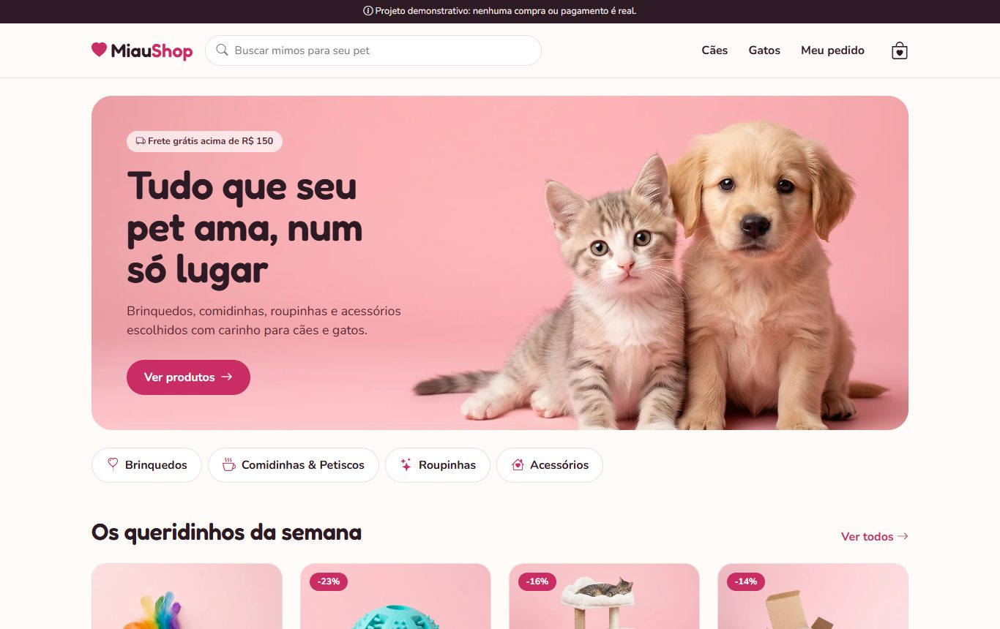<br /><sub><b>Página inicial</b> — banner, categorias e destaques</sub></td>
    <td width="50%">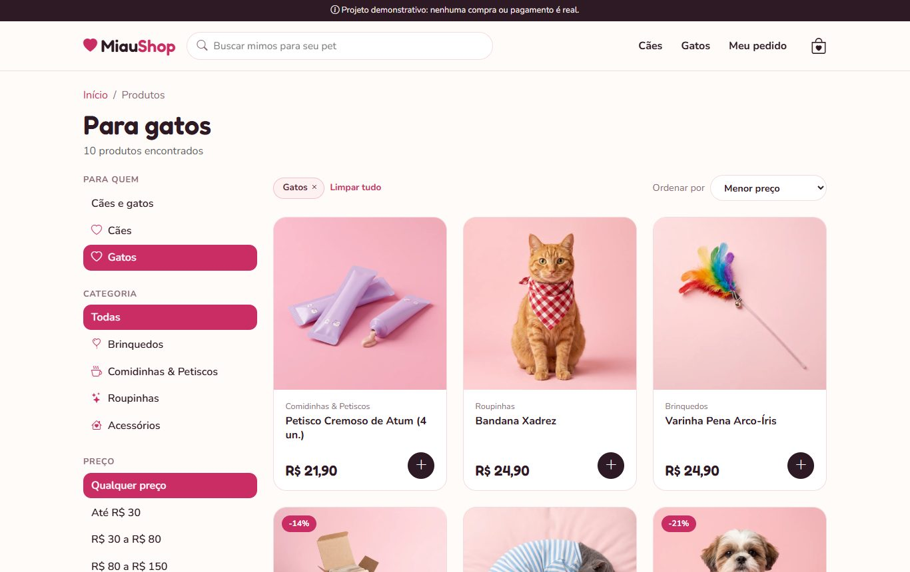<br /><sub><b>Catálogo</b> — filtros por animal, categoria, preço e promoção</sub></td>
  </tr>
  <tr>
    <td>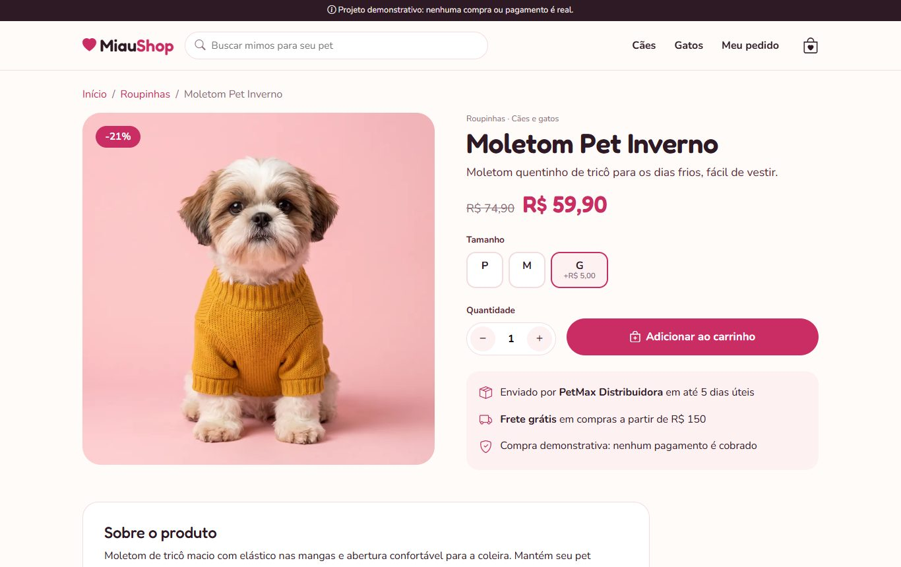<br /><sub><b>Produto</b> — o preço do tamanho vem do servidor</sub></td>
    <td>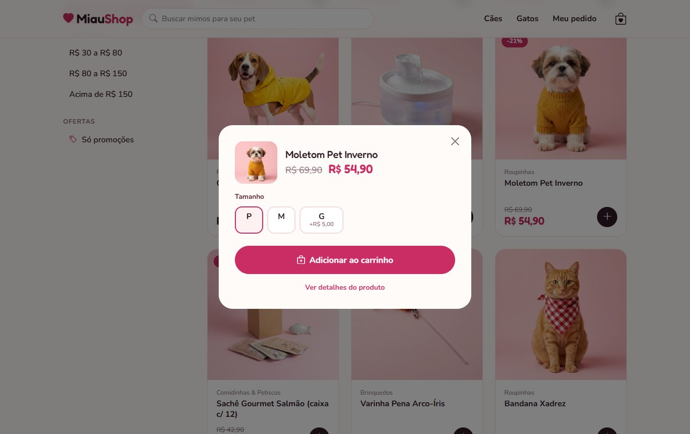<br /><sub><b>"+" do card</b> — escolha rápida de tamanho</sub></td>
  </tr>
  <tr>
    <td>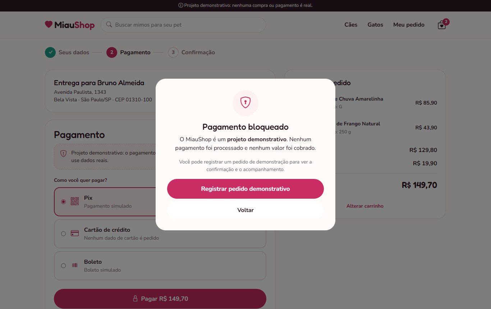<br /><sub><b>Checkout</b> — pagamento bloqueado (demonstração)</sub></td>
    <td>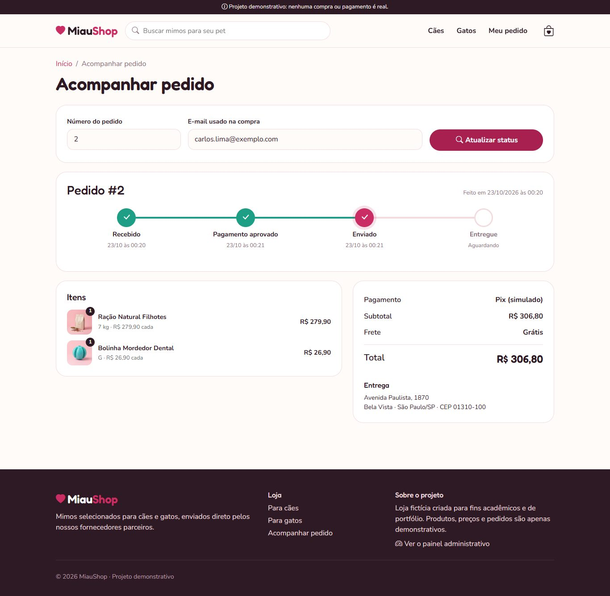<br /><sub><b>Acompanhamento</b> — linha do tempo do pedido</sub></td>
  </tr>
  <tr>
    <td>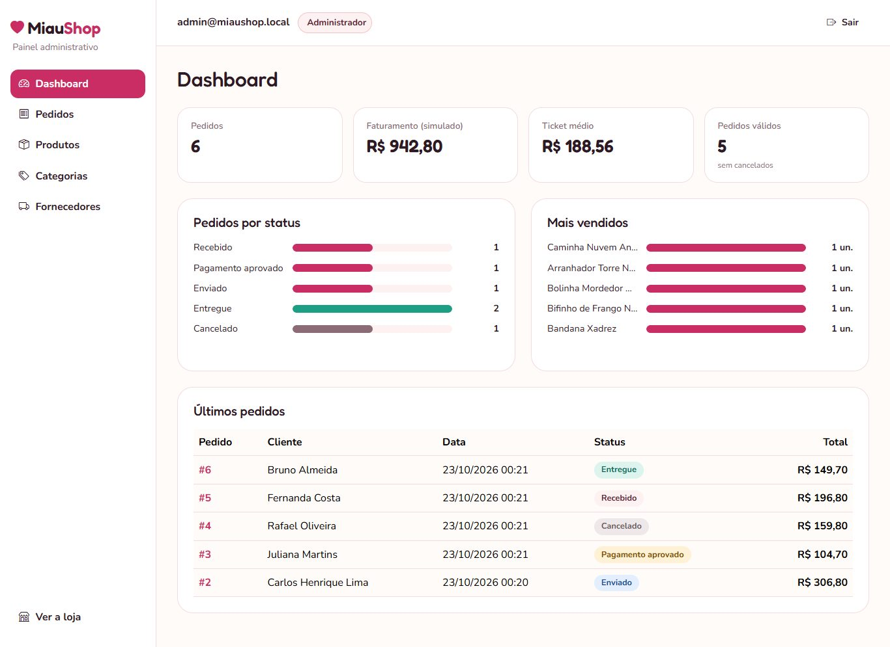<br /><sub><b>Dashboard</b> — números calculados no banco</sub></td>
    <td>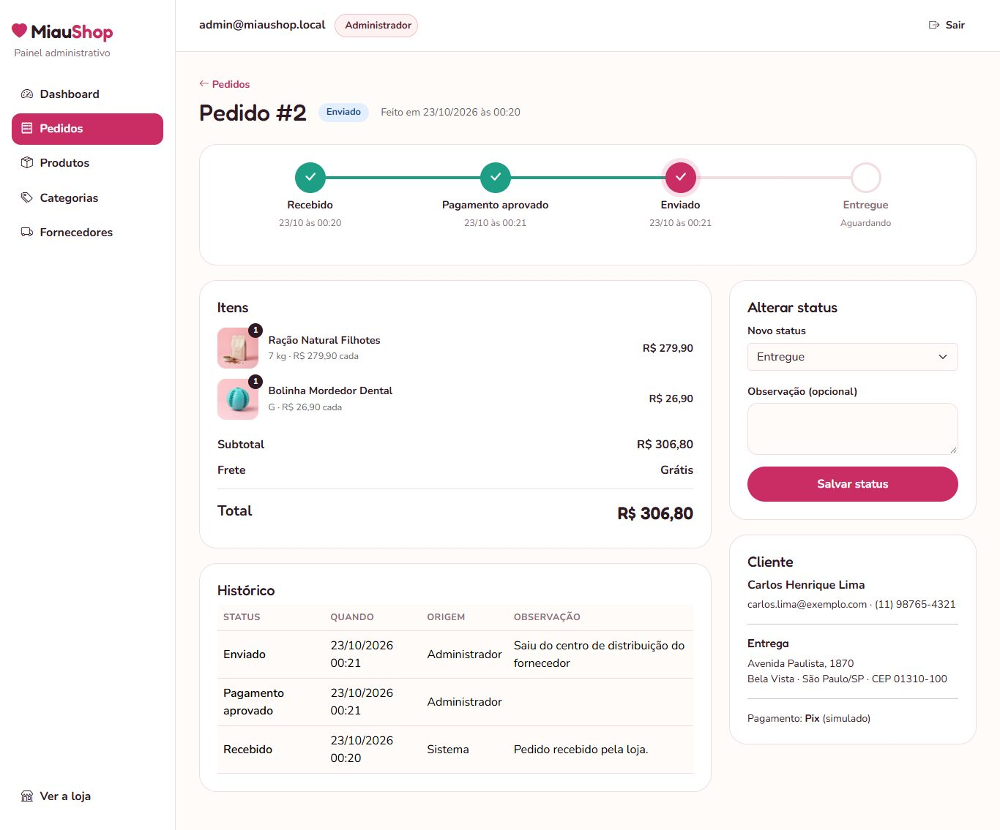<br /><sub><b>Gestão de pedidos</b> — status, histórico e cancelamento</sub></td>
  </tr>
</table>

<p align="center">
  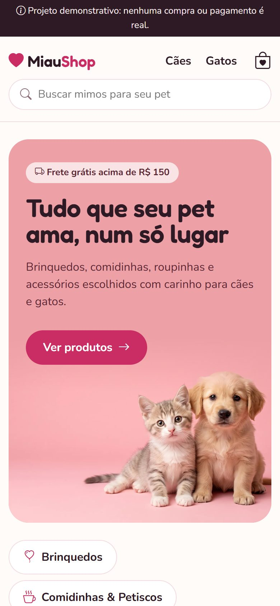
  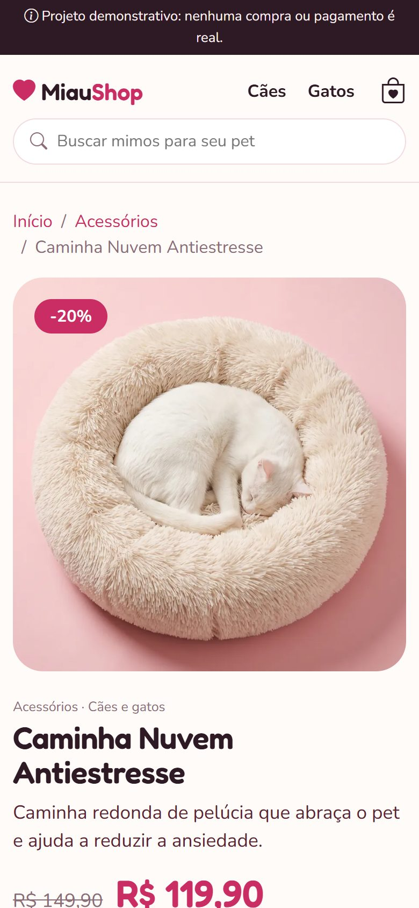
  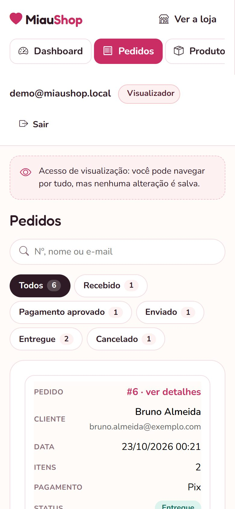
  <br /><sub>Responsivo: no celular, as tabelas do painel viram cartões e o menu desliza para o lado.</sub>
</p>

---

## Funcionalidades

### Loja
- Vitrine com destaques e promoções, catálogo com **filtros** (cães/gatos, categoria, faixa de preço, promoção), **busca** e **6 ordenações**
- Produtos com **variações** (tamanhos) que podem ter preço diferente; preço promocional com selo de desconto
- **Carrinho sem login** (sessão), com barra de **frete grátis** acima de R$ 150
- **Checkout em duas etapas**: dados com **endereço preenchido pelo CEP** (ViaCEP, validado no servidor) → pagamento simulado e bloqueado
- **Acompanhamento do pedido** por número + e-mail, com linha do tempo e limite de tentativas

### Painel administrativo (`/Admin`)
- **Dashboard**: pedidos, faturamento, ticket médio, pedidos por status e mais vendidos
- **Pedidos**: filtro por status, busca, detalhe, mudança de status (só transições válidas) e **cancelamento com motivo obrigatório**
- **Produtos** com variações e imagem, **categorias** e **fornecedores**
- Perfis **Administrador** (altera tudo) e **Visualizador** (somente leitura) — o acesso "visitante" do portfólio usa o Visualizador

---

## Decisões técnicas

| Decisão | Por quê |
|---|---|
| **Regras de preço, frete e promoção só no servidor** | O JavaScript nunca calcula valores: ele pede ao servidor um pedaço de HTML já pronto (*partial view*) e troca na tela. Ninguém altera preço pelo navegador. |
| **Pedido guarda uma "foto" do item** (nome e preço da compra) | Mudar o preço de um produto amanhã não altera pedidos antigos. |
| **Regras dentro das entidades** (`Pedido.AlterarStatus`, `Produto.ValidarRegras`) | Encapsulamento: o pedido não aceita transição inválida venha de onde vier (checkout, painel ou avanço automático). |
| **Categoria é dado, não classe** | Nada de `Racao : Produto`: criar categoria nova é cadastro no painel, não migração no banco. |
| **Papéis do ASP.NET Core Identity** (`Usuario` N:N `Papel`) | Padrão do framework para permissões, sem colunas duplicadas. |
| **Concorrência otimista com `xmin` do PostgreSQL** | Dois administradores editando o mesmo pedido/produto: o segundo é avisado em vez de sobrescrever. |
| **Status que avança "ao abrir o pedido"** | No plano gratuito o servidor dorme; em vez de um processo em segundo plano, o avanço automático (demonstração) acontece na consulta. Desligável por configuração. |
| **Repositório genérico + serviços por interface** | `IRepositorio<T>`, `ICalculadoraFrete`, `IConsultaCep`: trocar implementação sem mexer em quem usa. |

A modelagem completa (requisitos, diagramas de classes e fluxos) está em [`docs/modelagem.md`](docs/modelagem.md).

## Segurança

- Senhas guardadas só como **hash** (PBKDF2 + HMAC-SHA512, 100 mil iterações, salt por usuário — padrão do Identity)
- **Bloqueio** da conta após 5 senhas erradas e **limite de tentativas por IP** no login e na busca de pedidos
- Cookie de login `HttpOnly`, `Secure` e `SameSite=Strict`; **token antifalsificação** em todo formulário
- Leitura/escrita no banco só pelo Entity Framework (consultas parametrizadas — sem SQL concatenado)
- Cabeçalhos de segurança: **CSP**, `X-Frame-Options`, `X-Content-Type-Options`, `Referrer-Policy`, HSTS
- Nenhum segredo no repositório: conexão do banco e senha do administrador em **variáveis de ambiente** (Render) e **user secrets** (local)

## Arquitetura

```
Navegador ─► Controller ─► Service ─► Repository ─► AppDbContext (EF Core) ─► PostgreSQL
                 │            │
                 ▼            └─ regras de negócio (frete, checkout, status, catálogo)
        View (Razor) ◄─ ViewModel montado no servidor
```

```
MiauShop/
├── Areas/Admin/      # painel: controllers, views e view models próprios
├── Controllers/      # loja
├── Models/           # Entities, Enums, ValueObjects, ViewModels
├── Services/         # regras de negócio (+ Seguranca/)
├── Repositories/     # acesso a dados (interfaces + implementações)
├── Data/             # AppDbContext, Configurations, Migrations, seed
├── Views/ wwwroot/   # telas Razor, CSS, JS e imagens
MiauShop.Tests/       # testes xUnit das regras de negócio
```

## Stack

**Back-end:** C# · ASP.NET Core MVC (.NET 10 LTS) · Entity Framework Core 10 · ASP.NET Core Identity · xUnit
**Banco:** PostgreSQL 18 (Neon na nuvem · Docker no desenvolvimento)
**Front-end:** Razor · Bootstrap 5 com identidade visual própria · Bootstrap Icons · GSAP
**Integrações:** ViaCEP (endereço pelo CEP) · Mercado Pago Payment Brick (preparado, ligado por configuração)
**Deploy:** Docker · Render · Neon

## Como rodar localmente

Pré-requisitos: [.NET 10 SDK](https://dotnet.microsoft.com/download) e [Docker Desktop](https://www.docker.com/products/docker-desktop/).

```bash
# 1. Banco PostgreSQL local
docker compose up -d

# 2. (Opcional) conta de administrador — fica fora do repositório
dotnet user-secrets set "Administrador:Email" "admin@miaushop.local" --project MiauShop
dotnet user-secrets set "Administrador:Senha" "UmaSenhaForte1!" --project MiauShop

# 3. Rodar (as migrations e os produtos de exemplo são criados sozinhos)
dotnet run --project MiauShop

# 4. Testes
dotnet test
```

### Configuração (`appsettings.json`)

| Chave | Para quê |
|---|---|
| `Frete:ValorFixo` / `Frete:MinimoParaFreteGratis` | Regras do frete |
| `AvancoAutomatico:Habilitado` | Status do pedido avança sozinho (demonstração) — `false` para uso real |
| `Administrador:DemoHabilitada` | Botão "Entrar como visitante" — `false` para uso real |
| `MercadoPago:PublicKey` | Liga o Payment Brick do Mercado Pago (modo teste) |

No Render, as mesmas chaves viram variáveis de ambiente com `__` (ex.: `ConnectionStrings__MiauShop`, `Administrador__Senha`).

---

## Equipe

- Lucas Antonio Policene
- Murilo Grigoletto de Oliveira
- Pedro William Stein Hermes Brito
- Wilson Tucci Neto

<sub>Imagens dos produtos geradas com IA (Gemini). Marcas, produtos, clientes e pedidos exibidos são fictícios.</sub>
