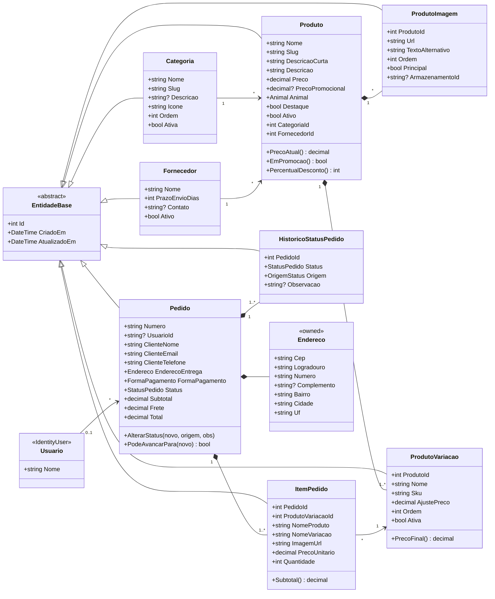
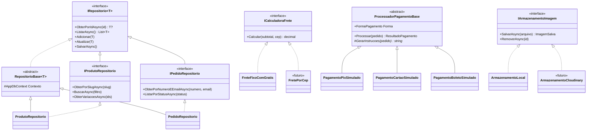
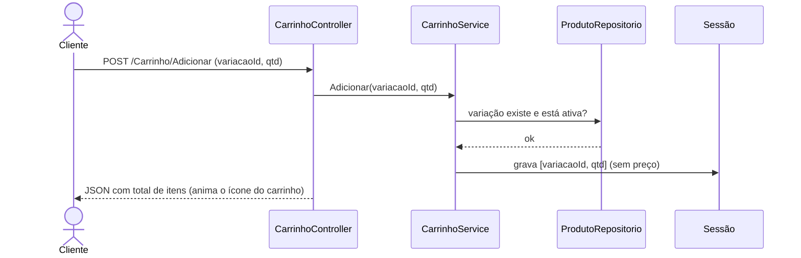
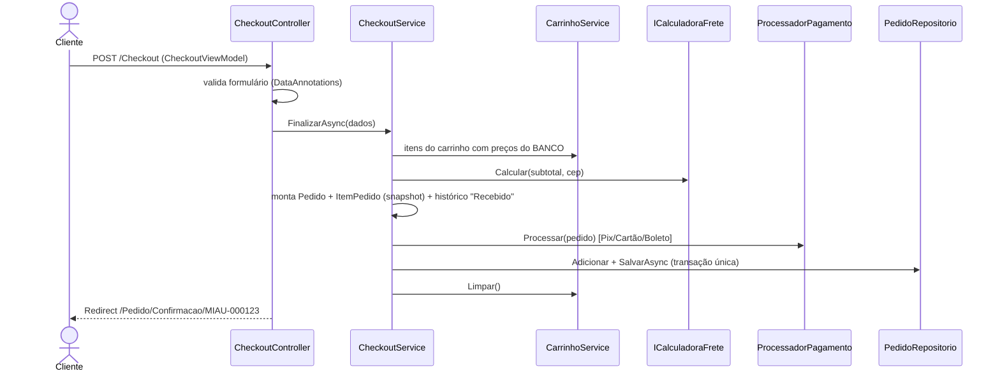
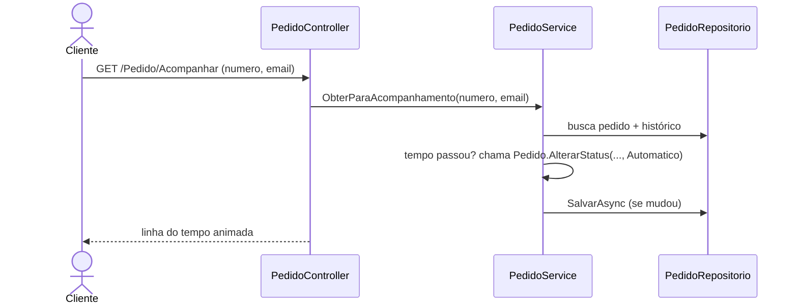

# MiauShop — Requisitos, Classes e Fluxo de Dados

> Documento de modelagem. Nenhuma linha de MVC é escrita antes de este documento ser aprovado.
> Objetivo: definir as classes e o banco **uma vez**, para não precisar mudar o banco depois.

---

## 1. Requisitos

### 1.1 Loja (cliente / visitante)

| ID | Requisito |
|---|---|
| RF01 | Ver vitrine com produtos em destaque e promoções |
| RF02 | Filtrar produtos por **animal** (Cães, Gatos) e por **categoria** (Brinquedos, Comidinhas & Petiscos, Roupinhas, Acessórios) |
| RF03 | Buscar produtos por nome |
| RF04 | Ver detalhe do produto: galeria de imagens, descrição, variações (ex.: tamanho P/M/G), preço e preço promocional, prazo de envio do fornecedor |
| RF05 | Adicionar, alterar quantidade e remover itens do carrinho **sem login** |
| RF06 | Ver subtotal, frete e total no carrinho (frete grátis acima de R$ 150, senão R$ 19,90) |
| RF07 | Finalizar compra (checkout simulado) informando nome, e-mail, telefone, endereço e forma de pagamento simulada (Pix, Cartão, Boleto) |
| RF08 | Receber número do pedido na tela de confirmação |
| RF09 | Acompanhar o pedido pelo **número + e-mail**, com linha do tempo de status |
| RF10 | Status avança sozinho com o tempo (demonstração) |

### 1.2 Painel administrativo

| ID | Requisito |
|---|---|
| RA01 | Login de administrador (área protegida) |
| RA02 | Dashboard: total de pedidos, faturamento simulado, pedidos por status, produtos mais vendidos |
| RA03 | CRUD de **categorias** (nome, ícone, ordem, ativa/inativa) |
| RA04 | CRUD de **fornecedores** (nome, prazo de envio, contato) |
| RA05 | CRUD de **produtos**, com variações e imagens |
| RA06 | Ativar/desativar produto (nunca apagar produto que já foi vendido) |
| RA07 | Listar pedidos com filtro por status e ver detalhes |
| RA08 | Alterar status do pedido manualmente (fica registrado no histórico como "Admin") |
| RA09 | Conta **demo só leitura** para visitantes do portfólio: vê todo o painel, mas nenhuma alteração é salva (papel `Demo` no Identity; o papel `Admin` tem acesso completo) |

### 1.3 Requisitos não funcionais

| ID | Requisito |
|---|---|
| RNF01 | Banner fixo "Projeto demonstrativo" em todas as páginas da loja |
| RNF02 | Rodar em hospedagem gratuita (Render + Neon); nada pode depender de arquivos salvos no servidor |
| RNF03 | Imagens em WebP, até ~150 KB cada |
| RNF04 | Animações respeitam `prefers-reduced-motion` |
| RNF05 | Preços **sempre** recalculados no servidor (o navegador nunca define preço) |
| RNF06 | Senhas com hash (ASP.NET Core Identity), nunca em texto puro |

---

## 2. Decisões de modelagem (e o porquê)

1. **Toda entidade herda de `EntidadeBase`** (Id, CriadoEm, AtualizadoEm). As datas são preenchidas automaticamente em um único lugar (`AppDbContext.SaveChanges`).
2. **Não existe `Racao : Produto`, `Brinquedo : Produto`.** Herança por tipo de produto obrigaria criar uma tabela/migração nova a cada categoria nova. Categoria é **dado** (o admin cria pelo painel), não **classe**.
3. **Todo produto tem pelo menos uma variação.** Produto sem tamanho tem a variação "Único". Assim o carrinho e o pedido sempre apontam para uma `ProdutoVariacao` — um único caminho, sem `if (temVariacao)` espalhado.
4. **O pedido guarda uma "foto" do item (snapshot):** nome, variação e preço no momento da compra. Se o admin mudar o preço amanhã, o pedido antigo não muda.
5. **Exclusão lógica:** produto e categoria têm `Ativo`; não são apagados, porque pedidos antigos apontam para eles.
6. **Carrinho não vai para o banco:** fica na sessão e guarda só `VariacaoId + Quantidade`. Preço é buscado no banco a cada exibição (RNF05).
7. **Status avança "preguiçosamente":** em vez de um robô rodando em segundo plano (que para quando o servidor grátis dorme), o status é atualizado quando alguém abre o pedido, com base no tempo que passou.
8. **Campos pensados para o futuro, já no banco agora:** `Pedido.UsuarioId` (opcional, para contas de cliente no futuro) e `ProdutoImagem.ArmazenamentoId` (para o Cloudinary). Ficam vazios por enquanto, mas evitam migração depois.
9. **Enums salvos como texto** no banco (`"Gato"`, não `1`): o banco fica legível e reordenar o enum não corrompe dados.

---

## 3. Diagrama de classes — Entidades (o que vira tabela)



### Enums

| Enum | Valores |
|---|---|
| `Animal` | `Cao`, `Gato`, `Ambos` |
| `StatusPedido` | `Recebido` → `PagamentoAprovado` → `Enviado` → `Entregue` (e `Cancelado`) |
| `FormaPagamento` | `Pix`, `Cartao`, `Boleto` |
| `OrigemStatus` | `Sistema`, `Automatico`, `Admin` |

### Regras que moram **dentro** das entidades (encapsulamento)

- `Produto.PrecoAtual()` → `PrecoPromocional ?? Preco`.
- `ProdutoVariacao.PrecoFinal()` → `Produto.PrecoAtual() + AjustePreco` (ex.: roupinha G custa R$ 5 a mais).
- `Pedido.AlterarStatus(...)` → só aceita transições válidas (não volta de `Entregue` para `Recebido`) e **sempre** cria um `HistoricoStatusPedido`. Ninguém altera `Status` direto (o `set` é privado).

---

## 4. Polimorfismo — onde e por quê

O polimorfismo fica nos **serviços**, não nas tabelas: trocamos comportamento sem mexer no banco.



| Ponto | Padrão | O que ganhamos |
|---|---|---|
| `IRepositorio<T>` + `RepositorioBase<T>` | Herança + genéricos | CRUD básico escrito **uma vez**; cada repositório só adiciona as consultas próprias |
| `ICalculadoraFrete` | Strategy | Hoje frete fixo/grátis; amanhã por CEP trocando **uma linha** no `Program.cs` |
| `ProcessadorPagamentoBase` | Template Method | Fluxo de pagamento igual para todos; cada forma só muda as instruções (QR Pix fake, boleto fake, cartão aprovado) |
| `IArmazenamentoImagem` | Strategy | Hoje imagens locais; amanhã Cloudinary sem mexer no admin |

---

## 5. Camadas e serviços

```
Controller  →  Service  →  Repository  →  AppDbContext  →  PostgreSQL
    ↑             │
 ViewModel  ←─────┘   (o Service devolve ViewModel/DTO, nunca a entidade crua para a View)
```

| Serviço | Responsabilidade |
|---|---|
| `CatalogoService` | Vitrine, filtros, busca, detalhe do produto |
| `CarrinhoService` | Ler/gravar carrinho na sessão; montar `CarrinhoViewModel` com preços do banco |
| `CheckoutService` | Validar carrinho, calcular frete, processar pagamento simulado, criar pedido |
| `PedidoService` | Acompanhamento, avanço automático de status, número do pedido |
| `Admin*Service` | Regras do painel (categorias, fornecedores, produtos, pedidos, dashboard) |

### Estrutura de pastas atualizada (com o admin como *Area*)

```
MiauShop/
├── Areas/
│   └── Admin/                 ← painel separado da loja (rotas /Admin/...)
│       ├── Controllers/
│       ├── ViewModels/
│       └── Views/
├── Controllers/               ← loja
├── Models/
│   ├── Entities/
│   ├── Enums/
│   ├── ValueObjects/          ← Endereco
│   └── ViewModels/
├── Services/
│   ├── Interfaces/
│   ├── Frete/
│   └── Pagamento/
├── Repositories/
│   └── Interfaces/
├── Data/
│   ├── AppDbContext.cs
│   ├── Configurations/        ← mapeamento de cada entidade (tamanhos, índices, decimais)
│   ├── Migrations/
│   └── SeedData.cs
└── Views/                     ← loja
```

---

## 6. Fluxos de dados

### 6.1 Adicionar ao carrinho



### 6.2 Finalizar compra



### 6.3 Acompanhar pedido (avanço automático)



Tempos sugeridos para a demonstração: **Pagamento aprovado** após 1 min, **Enviado** após 5 min, **Entregue** após 15 min.

---

## 7. Banco de dados (tabelas)

| Tabela | Chaves / índices importantes |
|---|---|
| `Categorias` | `Slug` único |
| `Fornecedores` | — |
| `Produtos` | `Slug` único; FK `CategoriaId`, `FornecedorId`; índice em `Animal`, `Ativo` |
| `ProdutoVariacoes` | `Sku` único; FK `ProdutoId` |
| `ProdutoImagens` | FK `ProdutoId` |
| `Pedidos` | `Numero` único; índice em `ClienteEmail`, `Status`; colunas do `Endereco` embutidas |
| `ItensPedido` | FK `PedidoId`, FK `ProdutoVariacaoId` (restrict: não apaga variação vendida) |
| `HistoricoStatusPedidos` | FK `PedidoId` |
| `AspNetUsers`, `AspNetRoles`, ... | Criadas pelo Identity (login do admin) |

Valores em dinheiro: `numeric(10,2)`.
